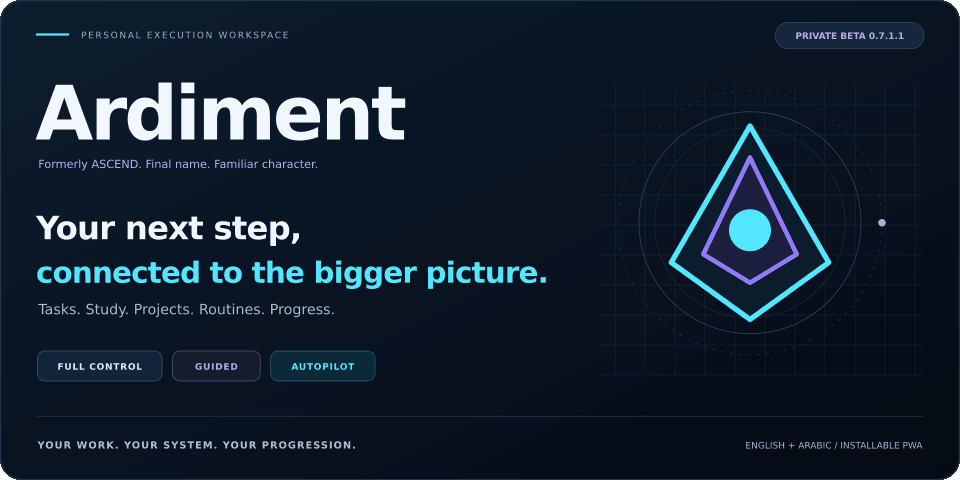
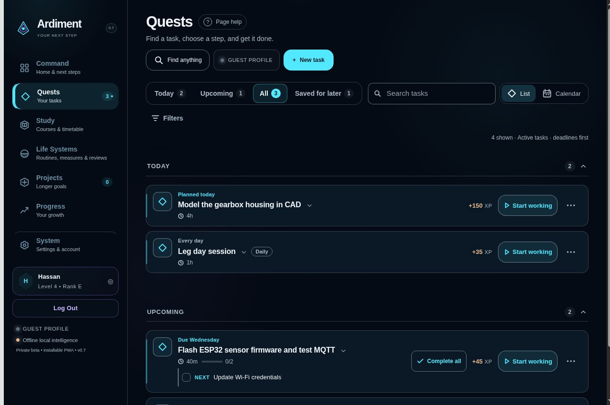
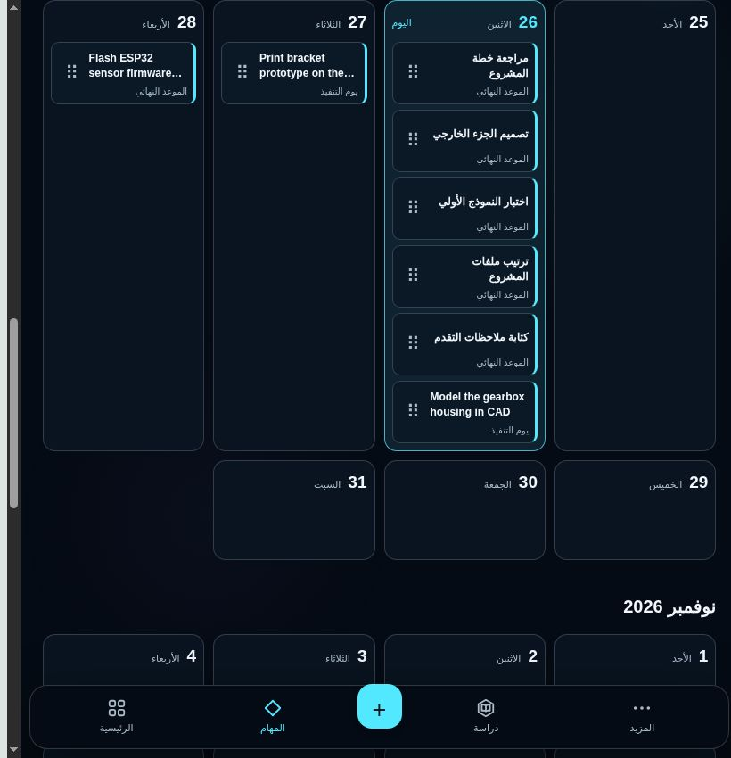
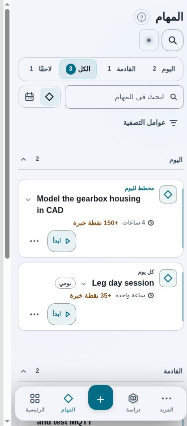
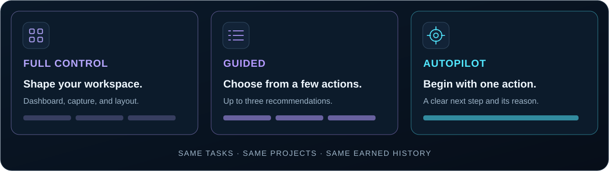
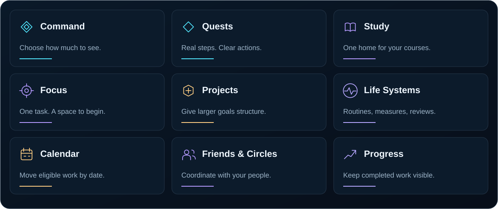
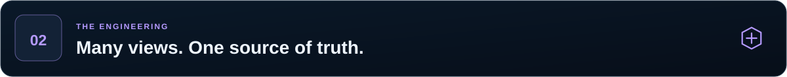
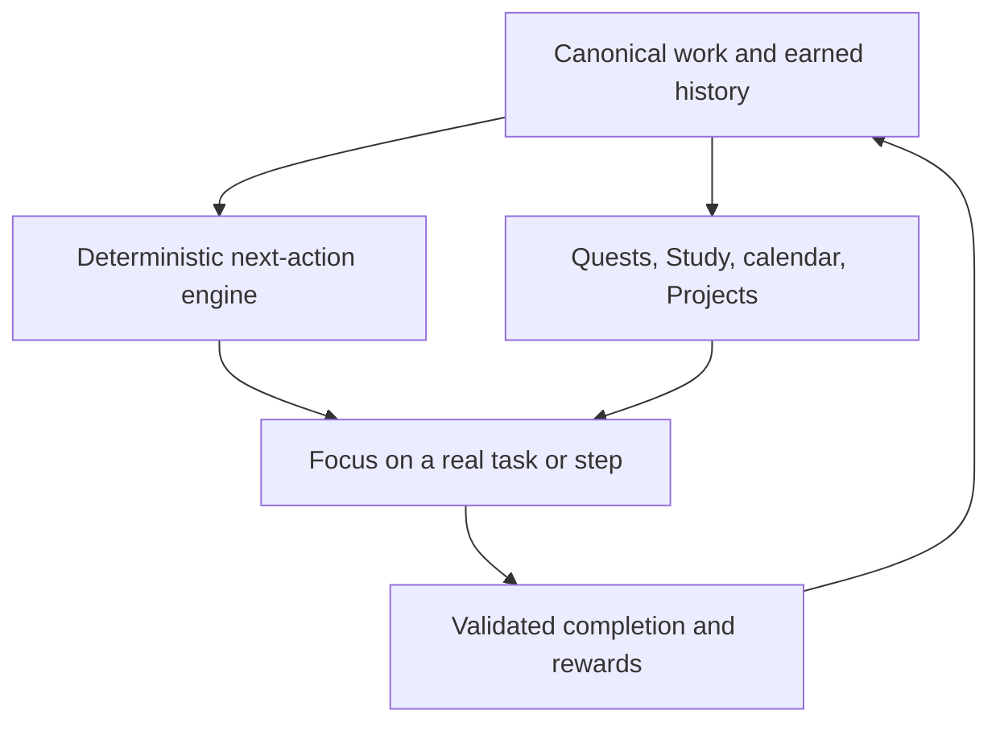
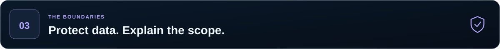
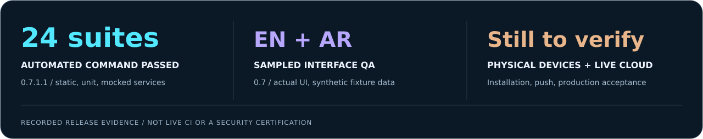

[Ardiment-README.md](https://github.com/user-attachments/files/33974291/Ardiment-README.md)

# Ardiment

<picture>
  <source media="(prefers-reduced-motion: reduce)" srcset="docs/assets/hero.png">
  
</picture>

### Your work. Your system. Your progression.

**A personal execution workspace for tasks, study, projects, routines, and the next useful action.**

**Plan when you want control. Begin when you need a clear next step.**

[Open Ardiment](https://ardiment-beta-nine.vercel.app) · [What changed](#from-ascend-to-ardiment) · [The experience](#three-experiences-one-workspace) · [Engineering](#engineering-architecture) · [Verification](#verification)

Created and directed by <a href="https://github.com/HassanAsali">Hassan Asali</a> · AI-assisted development · Private beta

> [!IMPORTANT]
> **ASCEND is now Ardiment.** The name is final. Version 0.7 introduced the identity and interface update; 0.7.1.1 removes a redundant appearance-settings entry. Existing work, progression, and account workflows continue under the new name.

> [!NOTE]
> This repository is a **product and engineering showcase**. It documents Ardiment 0.7.1.1; the older source snapshot included in this repository is historical and does not represent the complete current app. Updating these showcase files does not deploy the application. See [repository scope](docs/REPOSITORY.md).

## Why Ardiment exists

A task list can hold everything you need to do and still leave you unsure where to begin.

Ardiment connects organization with execution. Capture an idea, place it in its real context, open an unfinished step, and retain a record of the work you finish. Courses, projects, routines, and personal tasks share a workspace without losing their distinct purposes.

Its progression layer makes completed work visible through XP, levels, ranks, and transferable skills. Those indicators describe activity recorded in the app; they are not credentials or a measure of a person's worth.

| Clarity | Continuity | Control |
| :--- | :--- | :--- |
| A real next step, with enough context to begin. | The same task across lists, courses, calendar, and Focus. | A detailed dashboard, a few choices, or one action. |

## From ASCEND to Ardiment

The rebrand gives the existing product a consistent identity across its interface, installation experience, and communications. The familiar nested geometric emblem and cyan/violet character were retained and refined.

| Release | Delivered change |
| --- | --- |
| **0.7** | Ardiment naming, refined emblem and wordmarks, installation assets, coordinated light/dark styling, and English/Arabic brand copy. |
| **0.7** | Opaque full-viewport access gates that block interaction with the underlying workspace. |
| **0.7** | More compact task/calendar presentation and action menus sized to their contents. |
| **0.7** | **Complete all** for one task and its remaining steps, through the existing completion and reward rules. |
| **0.7.1.1** | Removed the duplicate **Advanced layout** section; **Theme & colors** remains the appearance entry point. |

The app's broader structure remains familiar: tasks, Study, Projects, Focus, Life Systems, progression, and optional collaboration. No new database migration was required for these releases.

Compatibility-sensitive names such as `ascend.*`, `ASCEND1`, and stable application identifiers remain where changing them could break saved data, encrypted recovery, or installations. They are internal compatibility details, not current product branding. [Read the rebrand and continuity notes →](docs/REBRAND.md)

## Inside the current interface

<table>
  <tr>
    <td width="68%" valign="top"> Arabic tablet calendar · compact task presentation</td>
    <td width="32%" valign="top"> Arabic phone layout · light theme</td>
  </tr>
</table>

Actual 0.7 interface captures using synthetic data in an isolated browser fixture. These are not physical-device or production-account tests. The 0.7.1.1 patch only removes the duplicate appearance entry; these captures are not presented as new patch screenshots.

## Three experiences, one workspace

<picture>
  <source media="(max-width: 640px)" srcset="docs/assets/experiences-mobile.svg">
  
</picture>

| Experience | What you see | When it helps |
| --- | --- | --- |
| **Full control** | A customizable Command dashboard with capture and optional information cards. | Plan, organize, and shape the workspace yourself. |
| **Guided** | Up to three suggested actions with short reasons. | Choose from a small set without opening the backlog. |
| **Autopilot** | One primary action with access to Start, details, and scheduling controls. | Open the app and begin. |

**Full control is the current default.** Changing modes changes presentation and recommendations over the same records. It does not create separate task stores or reset progress.

**Low Energy** uses an existing unfinished step or resource link, or asks for a concrete first step when the task lacks one. A brief start does not silently finish the objective or grant its full reward.

## Capture → organize → start → complete

1. **Capture:** type a task manually or submit a description for AI-assisted structure.
2. **Review:** confirm the proposed work and its real steps before accepting it.
3. **Organize:** connect it to a course, project, planned day, or appropriate list.
4. **Start:** open the task or next unfinished step in Focus.
5. **Complete:** record the actual work; eligible progression follows the task's rules.
6. **Continue:** return to the remaining work or choose another useful action.

For example, **Heat Transfer Assignment** can contain individual questions. Study supplies the course context, the calendar shows the planned day, and Focus can present **Solve Question 2**. Finishing it updates the original assignment. If the whole assignment is already done, **Complete all** finishes that task's remaining steps together.

> **Complete all applies to one task and its steps.** It does not mark the entire task list complete. Already-earned step rewards are preserved; locked project finals and future daily occurrences remain protected.

## Product workspaces

<picture>
  <source media="(max-width: 640px)" srcset="docs/assets/workspace-map-mobile.svg">
  
</picture>

| Workspace | Purpose | Established behavior |
| --- | --- | --- |
| **Command** | Capture work and choose a useful action. | Three experience modes; optional dashboard cards and layout preferences. |
| **Quests** | Find and execute tasks. | Today, Upcoming, All, saved work, search, compact cards, and expandable details. |
| **Calendar** | View the same tasks by date. | Four-column date layout, compact tiles, undated work, and controlled scheduling. |
| **Study** | Keep academic work in context. | Semesters, courses, weekly timetable, study units, course notes, and linked tasks. |
| **Focus** | Work on one real task or step. | Completion criteria, optional timing, pause/resume, parked thoughts, and continuity. |
| **Projects** | Structure larger outcomes. | Required/optional quests, substeps, reviewed AI breakdowns, and gated final objectives. |
| **Life Systems** | Record routines and personal measures. | Manual check-ins, bounded history, explicit links, and supported one-event Undo. |
| **Progress** | Keep completed work visible. | XP, levels, ranks, transferable skills, titles, and activity history. |
| **Friends & Circles** | Coordinate intentionally shared work. | Optional social information and collaboration with separate contribution rules. |
| **System** | Manage account, privacy, and preferences. | Appearance, recovery/backups, sharing, notifications, help, and version details. |

<strong>Task cards, calendar, and Focus</strong>

Cards lead with a title, useful context, an unfinished step, and a clear action. Additional steps and metadata open on demand. Calendar tiles use a denser presentation so several tasks on one day remain manageable; selecting a title opens the existing details and controls.

Planned dates and real deadlines are distinct. Rescheduling an eligible planned day does not quietly rewrite a deadline. Daily occurrences and completed history retain their own restrictions.

Focus refers to the canonical task or step. It has no separate task database. Starting a timer earns no XP; parked thoughts and session timing remain device-local. Reconciliation can account for a step completed elsewhere without discarding the session's parked notes.

<strong>Projects, routines, and collaboration</strong>

Projects keep large outcomes separate from daily work. Project tasks are off in general Focus recommendations by default, but an eligible task with its own explicit Today plan or real deadline can still appear. A project container is not treated as a single actionable step.

Life Systems check-ins and measures are records, not sources of personal quest XP. Friends use compact level/rank presentation rather than publishing raw XP in the current interface. Sharing remains an explicit preference.

Focus Circles and social collaboration are intentionally shared data scopes. They do not grant personal quest XP for coordination alone.

The encrypted external request portal lets someone propose work through an owner-created link. Proposals remain outside Quests until the owner reviews and accepts them. Receiving a request never completes a task or grants rewards.

<strong>English, Arabic, appearance, and motion</strong>

The interface supports English and Arabic, including RTL layouts. The name stays **Ardiment** in both languages; authored task text remains as written. A device's explicit per-account language choice stays stable during background sync, while the synced profile can seed a new device.

Theme & colors exposes appearance customization without a duplicate Advanced layout entry. Light/dark styling, typography, cards, icons, and feedback use the same visual system. Arabic-compatible system font fallbacks avoid a required remote font download.

Motion preferences and system reduced-motion settings are respected. Transitions communicate opening, navigation, or completion; the rebrand did not add another perpetual rendering loop. Notification and celebration durations are adjustable.

[See the current feature reference →](docs/FEATURES.md)

## Progression with rules

| Interaction | Personal progression |
| --- | --- |
| Finish an eligible quest or rewarded step | Applied through the task's completion rules. |
| Complete all remaining steps of one task | Uses the same completion path and remaining rewards. |
| Capture, sort, edit, or schedule | No completion reward for organization itself. |
| Start a timer or record a brief start | No automatic full-task reward. |
| Check in to a routine or record a measure | No personal quest XP. |
| Coordinate through Friends or Circles | No personal quest XP; circle rules are separate. |

Repeated completion must not create repeated rewards. Daily quests use date-aware occurrences: finishing today preserves its history and creates the next occurrence, which remains locked until its date. Project final objectives remain gated by required work.

Contextual Undo supports eligible edits, moves, and deletions while respecting newer changes and earned progress. Drafts preserve unfinished capture and AI-console text locally, scoped to the active identity; they are not automatically analyzed or included in ordinary synced progress/backups.

The standalone **Guide** and **Milestones** destinations from earlier versions are retired. Useful next-action assistance and progression history remain integrated into the current workspaces.

## Engineering architecture

Ardiment is a responsive browser PWA built with **HTML, CSS, vanilla JavaScript, Node.js, and Supabase/PostgreSQL**, with optional **Google Gemini** integration. The current application uses a shared service handler adapted for Node/serverless hosting.

| Layer | Responsibility |
| --- | --- |
| Interface/workspace modules | Rendering, capture, navigation, dialogs, localization, and feedback. |
| Domain modules | Routing, eligibility, recurrence, skills, scheduling, and reconciliation. |
| Scoped local persistence | Account/Guest separation, cached state, drafts, and pending changes. |
| Browser cryptography | Private progress, recovery, optional local protection, and encrypted backups. |
| Node service layer | Validated authenticated operations, provider access, requests, and optional services. |
| Supabase | Authentication, database persistence, and authorization policies. |
| PWA shell | Installation metadata, cached resources, and service-worker updates. |

### AI proposes; the user reviews

Gemini can structure submitted task descriptions and suggest project breakdowns. Manual capture remains available. Local assessment is a deterministic fallback, not an on-device language model equivalent to Gemini.

The next-action engine uses existing task data and local prioritization; it does not need a fresh generative request to choose every action. Eligibility is checked before ordering work by commitments, deadlines, explicit plans, routines, priority, and supported project context.

Provider keys stay server-side. Supported private/local analysis settings prevent submission to the external semantic provider; the app's own server may still process requests. Submitted AI content is a separate data path from encrypted cloud progress.

### Local-first saving and guarded sync

Local saving and cloud acknowledgement represent different facts. The synchronization layer retains pending work, compares local/remote state against an acknowledged base, and uses conditional writes to avoid blindly replacing concurrent device edits.

The coordinator coalesces rapid changes, serializes reconciliation, retries temporary failures, and avoids unchanged work where possible. Account and operation-generation checks reject stale asynchronous results after a switch or cancellation.

| Status | Meaning |
| --- | --- |
| **Saved on this device** | Work is retained locally; the relevant cloud update is not yet acknowledged. |
| **Syncing** | Reconciliation is in progress. |
| **Cloud updated** | A snapshot was acknowledged; newer changes may still be queued. |
| **Up to date** | Current reconciliation has settled against acknowledged state. |
| **Recovery/action needed** | Access or synchronization requires attention. |

Offline use depends on an available cached shell, accessible saved data, and the relevant unlock state. Sign-in, first-time cloud restoration, and server services still require connectivity. Reconciliation protects tested concurrent cases; it is not a claim that every possible conflict is automatically resolved.

## Privacy that explains its boundaries

| Data scope | Protection or boundary |
| --- | --- |
| **Private synced progress** | Browser-side AES-GCM before cloud upload, with authenticated access and per-user database policies. |
| **Optional local Privacy lock** | Encrypted saved application records in that browser, separate password/recovery, and manual/inactivity locking. |
| **Encrypted backup** | A portable data copy protected by its own export password and validated before confirmed restore. |
| **Incoming request content** | Client-side content encryption and public-key wrapping, followed by owner review. |
| **AI submissions** | Explicit submitted content and constrained context; external-provider consent is distinct from sync encryption. |
| **Friends/Circles and service metadata** | Authorized shared scopes, not the private encrypted progression vault. |

### Recovery is not a backup

**The account password signs you in. The Cloud Recovery File unlocks your encrypted progress. A backup contains a separate copy of your data.** Optional local Privacy lock has its own password and Local Recovery File.

An old Cloud Recovery File can remain valid if it belongs to the same account vault. It is not a dated snapshot of tasks. The `ASCEND1.` recovery prefix remains intentional after the rebrand. Changing the app's domain creates a separate browser-storage origin, so a new origin may ask for recovery even on a previously used device.

[Read the recovery and domain-change guide →](docs/RECOVERY.md)

Local encryption protects saved data while locked. It cannot protect an unlocked page from malicious code executing in that page, a compromised device, or a malicious future application build. Not every service record is end-to-end encrypted.

**Ardiment remains a private beta without an independent professional security audit.** Tests document specific behavior; they are not a security certification.

## Verification

| Evidence | Version and scope |
| --- | --- |
| **24 suites in `npm test` passed** | 0.7.1.1 full static, unit, crypto, and mocked-service regression command. |
| **Changed JavaScript syntax checked** | 0.7.1.1 appearance-settings patch. |
| **Complete-all regressions** | Partial completion, repeated activation, remaining XP, protected finals, future daily tasks, recurrence, and unrelated data preservation. |
| **Installation/cache checks** | Stable manifest identity, Ardiment display names, versioned shell, and offline asset aliases. |
| **Sampled actual-interface QA** | 0.7: English desktop at 1280px; Arabic tablet at 820px; Arabic light-mode phone at 375px, using synthetic browser-fixture data. |
| **Access and task interaction checks** | 0.7: viewport-sized restore gate, inert background, compact calendar/menu samples, and real keyboard activation of Complete all. |

The 0.7 interface captures and observations remain evidence for that release. The small 0.7.1.1 patch was checked through the regression suite and source/syntax review; a fresh physical-device/browser acceptance pass was not performed for it.

**Not established by these checks:** live Supabase account/policy behavior, real cross-device sync after a domain change, physical iPhone/iPad Safari installation, background push delivery, live AI requests, production FPS, complete accessibility, or independent security assurance. Historical 0.6.x benchmark/browser totals are not presented as current-release results.

[Verification details →](docs/VERIFICATION.md)

## Known issues and next validation

| Item | Current status |
| --- | --- |
| **Login bot-verification overlap** | User-reported on iPad and desktop: the Cloudflare widget overlaps security-check copy. Recorded for a later fix; **not fixed in 0.7.1.1**. |
| **Physical-device installation and offline updates** | Further acceptance testing required, including icon/name refresh behavior. |
| **Background reminders** | Depend on server setup, scheduling, device support, and per-device permission; real delivery requires device testing. |
| **Live account and sync acceptance** | Separate from mocked regression results; verify in the owner's deployment. |

[Tracked issues and acceptance criteria →](docs/KNOWN-ISSUES.md)

## Built through use and iteration

Ardiment is an **AI-assisted development project**. AI tools produce much of the implementation code. I define the product behavior, priorities, constraints, and expected outcomes, use the app myself, review results, and iterate when the implementation misses the intended experience.

The recurring challenges are concrete: several views must refer to the same work; concurrent edits must preserve earned history; canceled operations must not commit later; recovery must be understandable; and a visually rich interface must remain usable on a tablet or phone.

The working process is to define a behavior, exercise it, reproduce failures, make a targeted change, and check what must survive. The rebrand follows the same principle: evolve the product's identity while preserving the work people already recorded.

## Project reference

| Reference | Contents |
| --- | --- |
| [Features](docs/FEATURES.md) | Implemented capabilities, retained decisions, and setup-dependent behavior. |
| [Rebrand](docs/REBRAND.md) | ASCEND → Ardiment, compatibility exceptions, and domain continuity. |
| [Release notes](docs/RELEASES.md) | 0.6.5.5.3 baseline, 0.7 rebrand, and 0.7.1.1 refinement. |
| [Brand](docs/BRAND.md) | Naming, colors, typography, logo usage, and editable assets. |
| [Recovery](docs/RECOVERY.md) | Passwords, files, backups, and the retained recovery prefix. |
| [Verification](docs/VERIFICATION.md) | What was checked and what remains unverified. |
| [Known issues](docs/KNOWN-ISSUES.md) | Open layout issue and pending acceptance areas. |
| [Repository scope](docs/REPOSITORY.md) | Current documentation versus historical public source and images. |

<strong>Maintainer: publishing this showcase</strong>

Upload the root `README.md` and the accompanying `docs` folder together, preserving relative paths. The kit includes current illustrations, actual synthetic-data interface captures, editable brand assets, and English/Arabic upload instructions.

The existing historical source folder is not a current-release installation package. This documentation kit does not change application runtime files, deployment settings, authentication configuration, or repository visibility/license settings.

See [upload instructions](UPLOAD.md), [Arabic instructions](UPLOAD-AR.md), and [suggested repository metadata](REPOSITORY-SETTINGS.md). No domain, account, or repository name is changed by adding these files.

---

**One workspace. A useful next step. Progress that stays connected.**

[Back to top ↑](#ardiment)

