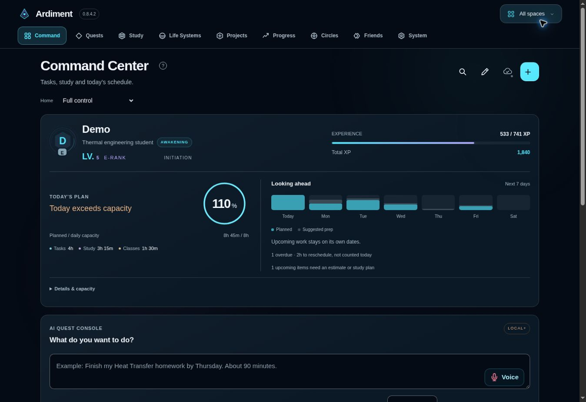
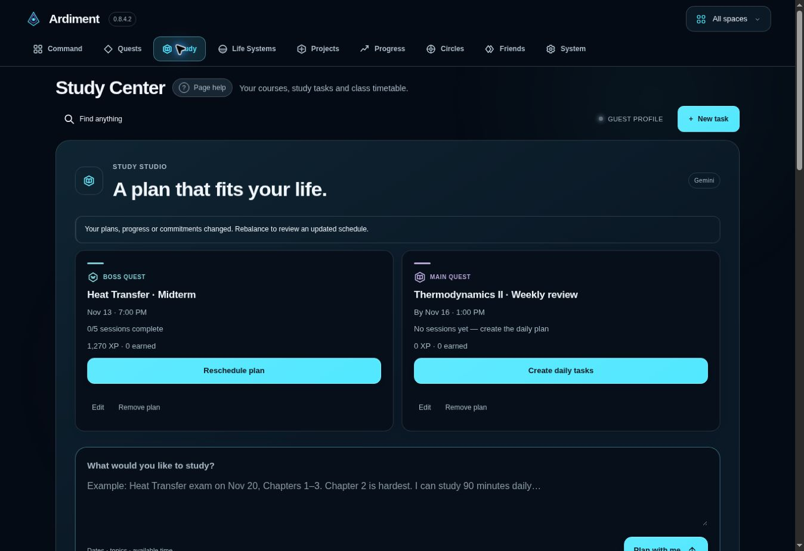
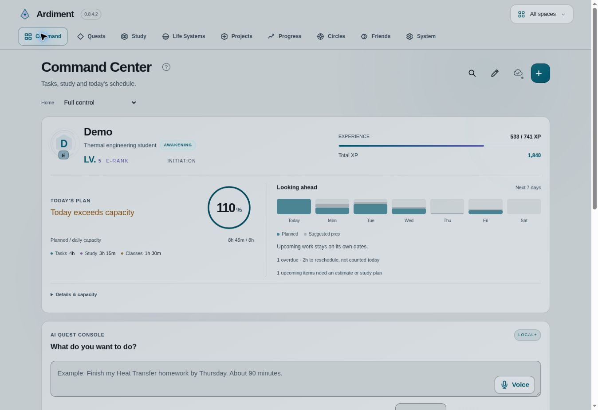
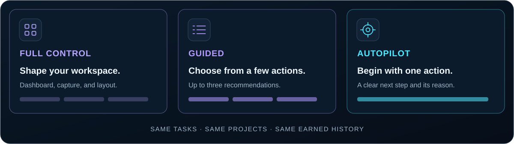
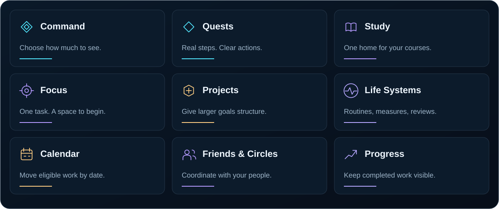

# Ardiment

### Your work. Your system. Your progression.

**A place for everything you need to do—and a clearer way to actually do it.**

Tasks. Study. Projects. Daily routines. One connected workspace.

**See what matters today. Know what is coming. Make your progress count.**

[See the workspace](#see-the-workspace) · [What’s new](#whats-new-in-0842) · [The experience](#three-experiences-one-workspace) · [Continuity](#built-for-continuity) · [Verification](#verification)

Created and directed by <a href="https://github.com/HassanAsali">Hassan Asali</a> · AI-assisted development · Private beta

## Why I’m building Ardiment

I wanted somewhere to put the things that actually fill my day: assignments, exams, projects, personal tasks and everything in between.

But writing everything down is only the beginning. I still need to know what to work on today, how much time it might take, and whether I am leaving enough room for what comes next.

That is what I want Ardiment to do well.

**Give me a clear picture. Give me a useful next step. Let me see the work I have actually finished.**

I use the app myself. When something feels confusing, looks crowded or gives an unrealistic picture of my day, it becomes something to improve. The aim is a workspace that feels calm and polished while handling real responsibilities.

Ardiment was previously known as **ASCEND**. The name changed; the work and progression stayed connected.

## See the workspace

### Your day, without losing the bigger picture

**Today has its own plan. The rest of the week has its own place.**

Command brings your current work, upcoming commitments and progression together. The circular indicator describes recorded work against available time; the outlook helps you see what is approaching without treating the whole backlog as today's job.

Actual 0.8.4.2 browser capture with synthetic demonstration data. The sample deliberately shows an over-capacity day; these are not a real user's tasks or a prediction of your workload.

### A study plan you can actually work through

**Tell it what you need to study. Keep the subject, the sessions and the progress connected.**

An exam and a normal review session are different goals. Study Studio gives each a clear place, with subject accents, plan-level progress and access to the daily work. The example above shows an exam plan alongside regular revision.

Actual 0.8.4.2 interface with synthetic plans. This browser demonstration is not evidence of a live Gemini request.

<strong>Prefer a softer light theme? See the same workspace.</strong>

Light mode keeps the same structure with muted surfaces and quieter contrast. The goal is a comfortable workspace, not a screen full of bright white panels.

Actual 0.8.4.2 browser capture with synthetic demonstration data.

> **About this showcase:** This page presents the prepared **0.8.4.2** release. The repository is a public product showcase, not the complete current application source. Release checks and remaining validation are documented below.

## What's new in 0.8.4.2

**An exam needs preparation. A quick review needs focus. The app should know the difference.**

- **Two purposes:** exam preparation becomes one **Boss Quest** plan; ordinary learning, reading, practice or revision becomes a **Main Quest** plan.
- **One subject at a time:** creating or rescheduling from a subject card affects that plan. A separate global action coordinates active plans.
- **Consistent plan rewards:** estimated total effort and plan type determine a plan's XP, distributed across its sessions. Splitting the same work into more sessions does not increase its reward.
- **Clear dates:** scheduled sessions appear under their dates. Work that cannot fit stays visibly queued inside its plan instead of cluttering the daily list without a date.
- **Useful names:** task titles include the subject plus the chapter or activity.
- **Protected progress:** completed, started, partially completed and pinned sessions retain their protected state. Scheduling itself awards no XP.
- **A quieter interface:** compact Command actions, hover/focus labels, accessible names, softer surfaces and restrained button depth preserve the familiar navy, cyan and violet identity.

## Study Studio: from a goal to daily work

Describe what you need in one conversation: subject, chapters, readiness, difficult topics, target date and available time. Gemini interprets the request for review; Ardiment's scheduler places accepted work around recorded commitments.

> **Regular study example:** Review Heat Transfer chapters 1–2 for 30 minutes total. This is normal revision, not an exam. Finish by November 12. I already know the fundamentals.

A short revision request should stay a short revision plan. Ordinary study does not automatically acquire mock exams or a full exam-preparation sequence. Its target date is a completion goal, not a fictional exam event. Missing dates or essential details prompt clarification.

For an exam, provide the real date and syllabus. Explicit chapter ranges inform learning units, practice and recall. “More” exposes topics, planned effort and remaining work. Distinct course accents make subjects easier to recognize.

### One plan, connected views

The parent mission stays in Study and the dedicated **Study plans** view in Quests. Its dated sessions also appear under their scheduled days. A plan gives you the full picture; a daily session gives you something manageable to do next.

A session can describe the subject, chapter, activity, expected effort and remaining work. The **More** view provides context when you need it, while the collapsed view stays compact enough to scan.

If work cannot fit, it stays visible inside the plan with a scheduling action. You can adjust availability, change an appropriate target date or explicitly choose a date. An unfinished session should remain understandable, not disappear into a confusing list.

**For older undated planner tasks:** choose **Reschedule plan** on the relevant subject, review and apply. Started or otherwise protected work may need a manual date. There is no need to delete the plan or erase completed progress.

### Different goals deserve different plans

| Your goal | What the experience should support |
| --- | --- |
| Prepare for a midterm | A connected exam plan with learning, practice and revision. |
| Review familiar chapters | A focused review plan without unnecessary introductory work. |
| Learn a topic normally | A regular-study plan with a clear scope and completion target. |
| Practise difficult material | Specific practice sessions and room to revisit weak areas. |
| Balance several subjects | A combined view of upcoming study, with individual subject control. |
| Continue a partly completed plan | Retain finished work and make the remaining work clear. |

Study durations remain estimates. Better descriptions, realistic availability and honest readiness make a plan more useful. The planner cannot know unrecorded commitments or guarantee mastery.

### Progress across the whole plan

Exam preparation is presented as one Boss Quest plan; ordinary learning is presented as a Main Quest plan. Sessions contribute to the plan’s visible progress and rewards. Completing a session and completing the whole plan are distinct milestones.

Already-earned progress is preserved. A scheduling change does not mean you have completed more work. Reopening a session should reflect that there is work left to do. Public documentation explains these outcomes without exposing the internal calculation rules.

## Today's plan, with room to look ahead

The Command ring shows **today's recorded workload divided by daily capacity**. It does not dump the entire backlog onto today.

| Work | Where it belongs |
| --- | --- |
| Work planned today and explicit due-today work | Today's plan, using recorded effort. |
| Future dated tasks and study sessions | Their own dates in the seven-day outlook. |
| Preparation suggested for a future deadline | Separately identified suggestions; not silently added to today's ring. |
| Overdue work | A visible rescheduling backlog; not automatically all charged to today. |
| Undated work | Outside the daily pressure calculation. |
| Missing effort or incomplete plans | Explicit uncertainty, rather than fabricated hours. |

Clock overlaps count once where supported. Scheduled study is not allocated again as preparation. Daily capacity is configurable and distinct from the study-only budget. These calculations describe recorded work, not passive time tracking or everything happening in someone's life.

## A calmer workspace

Customizable top shortcuts expose the app's spaces without implying that only three sections exist. A compact profile and XP strip sits above today's plan and upcoming work. Command's secondary actions use icons with hover/focus explanations; New task keeps a clear primary action.

Nine distinct palettes include a muted light theme. Course accents, readable profile initials, consistent action targets and restrained transitions keep the product recognizable across English and Arabic layouts.

## Changes across the 0.8 series

| Release family | Main additions and refinements |
| --- | --- |
| **0.8–0.8.1.1** | Coordinated exam planning, workload awareness, progression corrections and interface hardening. |
| **0.8.2** | Conversational Study Studio, expandable study missions, task-estimate context, shared agendas and calmer presentation. |
| **0.8.3 series** | Chapter-aware planning, dated study tasks, plan removal/restoration and AI request/response recovery. |
| **0.8.4** | Separated today's plan from upcoming preparation and overdue backlog; new top navigation. |
| **0.8.4.1 series** | Compact profile layout, configurable section shortcuts, shared-capacity fixes and cleaner page actions. |
| **0.8.4.2** | Regular-study versus exam plans, scoped generation, scheduling queues, whole-plan XP and refined controls. |

The 0.8 progression update makes advancement more approachable while preserving earned totals and established names. Other rank requirements still apply. The **Completed** view covers today and the preceding nine local calendar days; it limits presentation, not retention of the underlying history needed for rewards and sync.

## From ASCEND to Ardiment

The rebrand gives the existing product a consistent identity across its interface, installation experience, and communications. The familiar nested geometric emblem and cyan/violet character were retained and refined.

| Release | Delivered change |
| --- | --- |
| **0.7** | Ardiment naming, refined emblem and wordmarks, installation assets, coordinated light/dark styling, and English/Arabic brand copy. |
| **0.7** | Opaque full-viewport access gates that block interaction with the underlying workspace. |
| **0.7** | More compact task/calendar presentation and action menus sized to their contents. |
| **0.7** | **Complete all** for one task and its remaining steps, through the existing completion and reward rules. |
| **0.7.1.1** | Removed the duplicate **Advanced layout** section; **Theme & colors** remains the appearance entry point. |

The app's broader structure remains familiar: tasks, Study, Projects, Focus, Life Systems, progression, and optional collaboration. No new database migration was required for these releases.

The rebrand preserves existing work and account continuity. Technical compatibility details are intentionally outside this public overview.

## Three experiences, one workspace

<picture>
  <source media="(max-width: 640px)" srcset="docs/assets/experiences-mobile.svg">
  
</picture>

| Experience | What you see | When it helps |
| --- | --- | --- |
| **Full control** | A customizable Command dashboard with capture and optional information cards. | Plan, organize, and shape the workspace yourself. |
| **Guided** | Up to three suggested actions with short reasons. | Choose from a small set without opening the backlog. |
| **Autopilot** | One primary action with access to Start, details, and scheduling controls. | Open the app and begin. |

**Full control is the current default.** Changing modes changes presentation and recommendations over the same records. It does not create separate task stores or reset progress.

**Low Energy** uses an existing unfinished step or resource link, or asks for a concrete first step when the task lacks one. A brief start does not silently finish the objective or grant its full reward.

## From “I need to do this” to done

1. **Capture:** type a task manually or submit a description for AI-assisted structure.
2. **Review:** confirm the proposed work and its real steps before accepting it.
3. **Organize:** connect it to a course, project, planned day, or appropriate list.
4. **Start:** open the task or next unfinished step in Focus.
5. **Complete:** record the actual work; eligible progression follows the task's rules.
6. **Continue:** return to the remaining work or choose another useful action.

For example, **Heat Transfer Assignment** can contain individual questions. Study supplies the course context, the calendar shows the planned day, and Focus can present **Solve Question 2**. Finishing it updates the original assignment. If the whole assignment is already done, **Complete all** finishes that task's remaining steps together.

> **Complete all applies to one task and its steps.** It does not mark the entire task list complete. Already-earned step rewards are preserved; locked project finals and future daily occurrences remain protected.

## Product workspaces

<picture>
  <source media="(max-width: 640px)" srcset="docs/assets/workspace-map-mobile.svg">
  
</picture>

| Workspace | Purpose | Established behavior |
| --- | --- | --- |
| **Command** | Capture work and choose a useful action. | Three modes, customizable section shortcuts, compact actions, today’s workload and seven-day outlook. |
| **Quests** | Find and execute tasks. | Dated groups, Study plans, Completed, saved work, search and expandable details. |
| **Calendar** | View the same tasks by date. | Four-column date layout, compact tiles, undated work, and controlled scheduling. |
| **Study** | Keep academic work in context. | Conversational study/exam plans, daily sessions, whole-plan XP, semesters, courses and timetable. |
| **Focus** | Work on one real task or step. | Completion criteria, optional timing, pause/resume, parked thoughts, and continuity. |
| **Projects** | Structure larger outcomes. | Required/optional quests, substeps, reviewed AI breakdowns, and gated final objectives. |
| **Life Systems** | Record routines and personal measures. | Manual check-ins, bounded history, explicit links, and supported one-event Undo. |
| **Progress** | Keep completed work visible. | XP, levels, ranks, transferable skills, titles, and activity history. |
| **Friends & Circles** | Coordinate intentionally shared work. | Shared agendas, session starters, explicit check-ins and reviewed handoff to personal tasks; separate contribution rules. |
| **System** | Manage account, privacy, and preferences. | Appearance, recovery/backups, sharing, notifications, help, and version details. |

<strong>Task cards, calendar, and Focus</strong>

Cards lead with a title, useful context, an unfinished step, and a clear action. Additional steps and metadata open on demand. Calendar tiles use a denser presentation so several tasks on one day remain manageable; selecting a title opens the existing details and controls.

Planned dates and real deadlines are distinct. Rescheduling an eligible planned day does not quietly rewrite a deadline. Daily occurrences and completed history retain their own restrictions.

Focus opens the original task or step. Starting a timer earns no XP; parked thoughts and session timing remain device-local. Reconciliation can account for a step completed elsewhere without discarding the session's parked notes.

<strong>Projects, routines, and collaboration</strong>

Projects keep large outcomes separate from daily work. Project tasks are off in general Focus recommendations by default, but an eligible task with its own explicit Today plan or real deadline can still appear. A project container is not treated as a single actionable step.

Life Systems check-ins and measures are records, not sources of personal quest XP. Friends use compact level/rank presentation rather than publishing raw XP in the current interface. Sharing remains an explicit preference.

Focus Circles and social collaboration are intentionally shared data scopes. They do not grant personal quest XP for coordination alone.

The external request portal lets someone propose work through an owner-created link. Proposals remain outside Quests until the owner reviews and accepts them. Receiving a request never completes a task or grants rewards.

<strong>English, Arabic, appearance, and motion</strong>

The interface supports English and Arabic, including RTL layouts. The name stays **Ardiment** in both languages; authored task text remains as written. A device's explicit per-account language choice stays stable during background sync, while the synced profile can seed a new device.

Theme & colors exposes appearance customization without a duplicate Advanced layout entry. Light/dark styling, typography, cards, icons, and feedback use the same visual system. Arabic-compatible system font fallbacks avoid a required remote font download.

Motion preferences and system reduced-motion settings are respected. Transitions communicate opening, navigation, or completion; the rebrand did not add another perpetual rendering loop. Notification and celebration durations are adjustable.

[Earlier feature reference (0.7 showcase) →](docs/FEATURES.md)

## Progress you can see

| Interaction | Personal progression |
| --- | --- |
| Finish an eligible quest or rewarded step | Applied through the task's completion rules. |
| Complete all remaining steps of one task | Uses the same completion path and remaining rewards. |
| Capture, sort, edit, or schedule | No completion reward for organization itself. |
| Start a timer or record a brief start | No automatic full-task reward. |
| Check in to a routine or record a measure | No personal quest XP. |
| Coordinate through Friends or Circles | No personal quest XP; circle rules are separate. |

Repeated completion must not create repeated rewards. Daily quests use date-aware occurrences: finishing today preserves its history and creates the next occurrence, which remains locked until its date. Project final objectives remain gated by required work.

Contextual Undo supports eligible edits, moves and deletions. Drafts help retain unfinished capture text without automatically submitting it to AI.

The standalone **Guide** and **Milestones** destinations from earlier versions are retired. Useful next-action assistance and progression history remain integrated into the current workspaces.

## A day with Ardiment

### Start with the day you actually have

Open Command to see your current progress, today's plan and the shape of the coming days. The point is to understand what belongs today before opening every list.

If you want control, stay in Full control and arrange the available cards. If you are overwhelmed, switch to a smaller set of choices or one suggested action. Your work stays connected as the presentation changes.

### Turn a vague intention into something usable

“I need to study Heat Transfer” is a starting point. Adding the chapters, target date, available time and what you already know gives the planner something more useful to work with.

For ordinary tasks, a description can become a reviewed task with steps and context. Manual entry remains available when you already know exactly what you want.

### Begin at the right level

A project is too broad to be the next action. A study plan may cover several days. Focus helps you work on a specific task or unfinished step without needing to inspect the entire outcome at once.

You can begin, pause and return. Starting is not the same as finishing, and time spent with a timer is not automatically treated as completion.

### See what moved forward

Record completed work and return to the remaining plan. The Completed view provides a recent daily record, while progression makes sustained activity visible over time.

If a task was completed by mistake, eligible reopening controls help correct the record. If the schedule changes, revisit the plan instead of pretending that the original dates still fit.

## Different days. The same connected workspace.

<strong>For a student managing several courses</strong>

Keep courses and class times in Study. Add a study goal with its real scope, then review the proposed daily work. Subject accents distinguish plans; subject names stay visible in session titles.

An exam plan can sit alongside regular revision and coursework. You can open the complete plan when you want context, or work from the dated task list when you need today's sessions.

When another deadline appears, review the timetable again. Completed work remains part of the record. Work that needs more time stays visible rather than being presented as already scheduled.

<strong>For someone building a longer project</strong>

Use Projects to describe the outcome and break it into actionable work. Required work and final objectives retain their relationship, while daily execution happens at the task or step level.

An AI-assisted breakdown can help with the first structure, but you review it before accepting. Links and completion criteria give the next session enough context to begin.

The goal is to move between the larger outcome and the next useful action without losing the relationship between them.

<strong>For a busy week with changing priorities</strong>

Use planned days to express when you intend to work and deadlines to represent actual commitments. The upcoming view groups dated work so a week does not become one undifferentiated backlog.

Command separates today's plan from the outlook. Overdue work remains visible for rescheduling, and unscheduled ideas do not automatically become today's pressure.

Review the estimates when the picture feels wrong. An indicator is useful only when the tasks, dates and available time behind it reflect your situation.

<strong>For colleagues who want to work together</strong>

Friends and Circles provide optional places for intentionally shared plans and group focus. Shared agendas, session starters and explicit check-ins help turn coordination into an action.

A reviewed handoff can bring relevant work into a personal task list. Personal progress remains distinct from simply participating in a group or coordinating a session.

These features complement individual planning. They are not presented as a full workplace chat, document suite or enterprise project-management service.

## Designed to stay understandable

**Details when you need them.** A compact card can expand into steps and context. Study missions offer a whole-plan view without requiring every session to remain open.

**Clear actions.** Start, complete, edit, schedule and remove have different purposes. Important actions should communicate what will happen, while icon-only controls retain explanatory labels.

**A familiar identity.** Dark navy, cyan and violet remain central to Ardiment. Softer surfaces and distinct course accents improve scanning without turning the app into a different product.

**A comfortable light theme.** Light mode uses muted surfaces rather than an excessively bright white canvas. Theme choices extend across shared controls, profile elements and readable icons.

**English and Arabic.** Navigation and interface copy support both languages. The brand name stays Ardiment, and personal task text remains as written.

**Motion with restraint.** Transitions help explain navigation and changes. Reduced-motion preferences are respected; visual feedback should support the work rather than compete with it.

**Control over the workspace.** Section shortcuts and dashboard preferences let you choose what stays visible. You can keep a fuller overview or reduce the amount of information competing for attention.

## A few things worth knowing

<strong>Is Ardiment only for students?</strong>

No. Study is a dedicated workspace, but the app also covers personal tasks, projects, routines, planning and progression. Academic work can live alongside other responsibilities without defining the whole product.

<strong>Do I need an exam to use the study planner?</strong>

No. Regular learning, practice and revision are supported. Describe the intended scope and target completion date. Review the plan type before accepting it so normal study is not treated as an exam.

<strong>Can I use it without AI?</strong>

Manual task capture and established organization workflows remain available. New AI-generated study content and conversational interpretation require the relevant online service and consent. AI assistance does not replace reviewing the result.

<strong>Does the workload percentage measure my actual stress?</strong>

No. It summarizes recorded planned work against available time. It is not a medical, emotional or passive activity measurement. Missing tasks, inaccurate estimates or unrecorded commitments can change how representative it is.

<strong>What happens if a study plan cannot fit?</strong>

The remaining sessions stay visible inside the plan as work needing a time slot. Review the scope, target date and availability. You can then reschedule or explicitly set a date instead of losing those sessions.

<strong>Does Complete all finish every task?</strong>

No. It applies to the selected task and its remaining steps. It is useful when the work is already finished and checking each step separately would be unnecessary.

<strong>Will changing appearance reset my work?</strong>

Appearance and experience modes change how the workspace is presented. They do not create a separate set of tasks or intentionally reset earned history.

<strong>Does the recent Completed view delete my old progress?</strong>

No. The recent view focuses on the last ten local calendar days. Older underlying history is retained where needed for progression and continuity.

<strong>Is it available as a native iPhone app?</strong>

The current product is an installable web app. Native App Store distribution is a separate future release effort, not a capability claimed by this README.

<strong>Is this repository the complete current application?</strong>

No. This repository is the public showcase. This README describes the prepared 0.8.4.2 application release; the running deployment and historical supporting files may represent different versions.

## Built for continuity

Ardiment is an installable web app designed to keep related work connected across its views. The task opened from a course, a date or a plan remains the same piece of work. Completing it should be reflected wherever that work appears.

### Saving and synchronization

Guest mode provides a device-local workspace. Account features support saving and synchronization across supported devices when configured and available. The interface distinguishes locally saved work, synchronization in progress and acknowledged cloud updates.

Offline availability depends on the app and relevant data already being available on the device. First-time sign-in, account restoration and online AI assistance require connectivity. A status indicator helps explain when further action is needed.

### Privacy in everyday use

- AI assistance is optional, and submissions are reviewed through the relevant consent flow.
- Account, backup and recovery controls are available in System.
- Sharing with other people is an intentional action, separate from ordinary private task management.
- Guest mode and account mode have different saving and synchronization expectations.
- Technical reports can be inspected before sharing; reporting a problem should not require publishing a personal task list.

**A password, a recovery file and a backup serve different purposes.** Keep recovery material and backups private. The app’s help and recovery guidance explain which item is needed for a particular action.

This public showcase deliberately omits internal algorithms, reward calculations, storage identifiers, database structure, operational configuration and security implementation details. Ardiment remains a private beta; no independent security certification is claimed.

## Verification

The following results belong to the prepared **0.8.4.2 application package**, tested locally on November 8, 2026. They are not tests of this documentation repository or proof of the live deployment.

| Evidence | Scope |
| --- | --- |
| **37 automated suites passed** | Application regression checks covering core workflows, planning, progression, continuity and simulated service responses. |
| **15 new study checks passed** | Study purpose, consistent rewards, preserved progress, selected-subject planning and scheduling constraints. |
| **15 browser integration checks passed** | Synthetic-data browser workflows covering study creation, completion, reopening, editing and scheduling. |
| **Responsive samples** | English/dark desktop and tablet; Arabic/light Study at 375 px and Command at 320 px. No detected horizontal/field overflow or broken images in audited views. |
| **Nine theme samples** | No detected overflow; sampled text, profile initials and button-base contrast; data unchanged by theme switching. |
| **Toolbar interactions** | Search, New task, Customize and Cloud/sync settings opened the intended surfaces. The sync settings card remained visible. |

Final focused smoke and study checks passed after the last CSS/copy refinements. Detailed verification accompanies the application release. These results describe the prepared package, not a claim that the live deployment has passed the same acceptance checks.

**Still requires real-world acceptance:** live Gemini/model configuration, production Supabase login and cross-device sync, physical iPhone/iPad Safari/PWA installation and updates, real background notifications, and complete accessibility testing. No independent professional security audit or App Store certification is claimed.

[Historical verification reference →](docs/VERIFICATION.md)

## Availability and release status

Ardiment is an **installable web app in private beta**, not yet a native App Store release. Its responsive layout, touch-friendly controls, motion preferences and installation experience support everyday use across desktop, tablet and phone.

The latest prepared application release described here is **0.8.4.2**. The deployed app may be running a different version; check the version shown inside Ardiment. Editing this README changes the showcase, not the running app.

The direction is a more complete mobile product while retaining the flexibility of the web workspace. Native packaging, store submission and real-device acceptance remain separate work.

## Remaining validation

- Test the owner’s real Gemini configuration and representative study requests after deployment.
- Verify login, recovery and encrypted sync between actual devices.
- Check iPhone/iPad installation, offline updates and notification permissions/delivery.
- Continue accessibility, layout and scheduling edge-case testing with real use.

Older issue documents describe the state of their original release. An issue’s absence from this README is not proof that every historical case has been retested.

## Built, used, questioned, improved

I am **Hassan Asali**, a Mechanical Engineering student, and Ardiment is a product I am building around work I actually need to get done.

I care about the details: a study session should say which subject it belongs to. A workload indicator should help me understand my day. A button should do something useful. The interface should feel good to use without getting in the way.

That is also how the app improves. I use it, notice what feels wrong, define the behavior I need and work through the next iteration. Some changes are visual. Others are about making the underlying experience more reliable.

Development is **AI-assisted**. AI tools produce much of the implementation code; I direct the product, define priorities, review the results and test it through everyday use. This is an actively developing private beta, and the verification section separates local evidence from what still needs real-world testing.

**The standard I’m working toward is simple: useful enough to rely on, clear enough to understand, and polished enough to enjoy opening.**

## About this showcase

This page describes the product's visible experience and latest prepared release. Older supporting media and documents remain in the repository for historical context; they should not be mistaken for current screenshots, a complete application package or a public technical specification.

The public description intentionally focuses on what people can do with Ardiment, how the workspaces connect and what has actually been checked. Private operational information and internal implementation rules are outside its scope.

---

**Ardiment · Private beta 0.8.4.2**

**Less scattered. More connected. One useful step at a time.**

[Back to top ↑](#ardiment)

